<div align="center">

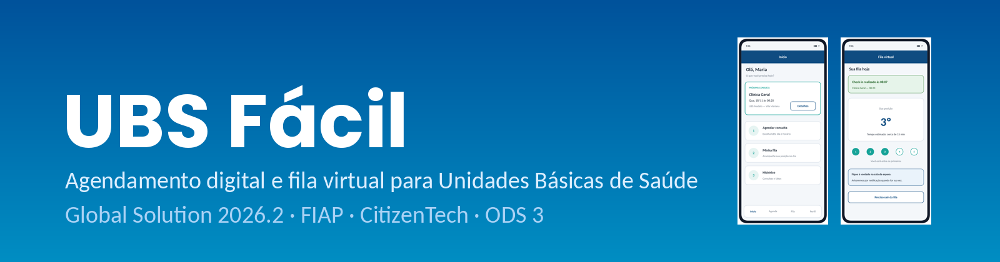

<br>

**Marque a consulta pelo celular. Acompanhe a fila de casa. Sem madrugada, sem papel, sem vaga perdida.**

[O problema](#problema) · [A solução](#solucao) · [MVP](#mvp) · [Protótipo](#prototipo) · [Processos BPMN](#bpmn) · [Storyboard](#storyboard) · [Backlog](#backlog) · [Equipe](#equipe)

</div>

---

## 📌 Sobre o projeto

O **UBS Fácil** é uma proposta de agendamento digital e fila virtual para Unidades Básicas de Saúde (UBS), criada na **Global Solution 2026.2 da FIAP** (desafio **CitizenTech**). Este repositório reúne toda a documentação de análise e projeto do sistema: processo de produção, modelagem de processos, protótipo e storyboard.

| | |
|---|---|
| **Disciplina** | Business Systems Planning, Analysis & Design |
| **Professor** | Prof. Me. Junior F. de Amaral |
| **Turma** | FIAP 2SI · 2026 |
| **ODS principal** | ODS 3, meta 3.8 (acesso a serviços essenciais de saúde) |
| **ODS secundário** | ODS 10, meta 10.2 (inclusão de todos, inclusive quem não usa smartphone) |
| **Persona** | Maria, 62 anos, moradora da Vila Mariana |

<a id="problema"></a>

## 😟 O problema

Em muitas UBS, conseguir uma consulta ainda exige ir à unidade de madrugada para disputar um número limitado de vagas. O agendamento é feito em papel, sem comprovante e sem lembrete.

- Quem não consegue chegar cedo fica sem atendimento.
- Quem agenda e esquece de ir deixa a vaga vazia, e ninguém é chamado no lugar.
- A unidade não enxerga a demanda real nem a fila do dia.

<a id="solucao"></a>

## 💡 A solução

Um **aplicativo para o cidadão** e um **painel web para a recepção**.

| Para o cidadão | Para a UBS |
|---|---|
| Agendar por unidade, atendimento, dia e horário livre | Painel com a fila do dia em tempo real |
| Comprovante com **QR Code** | Agendamento assistido para quem não usa smartphone |
| Lembrete 24 h antes, com confirmar ou cancelar em um toque | Vaga cancelada volta para a agenda na hora |
| **Fila virtual** com posição e tempo estimado | Lista de espera preenchendo as faltas |
| Interface com fonte grande e alto contraste | Menos fila física e menos faltas |

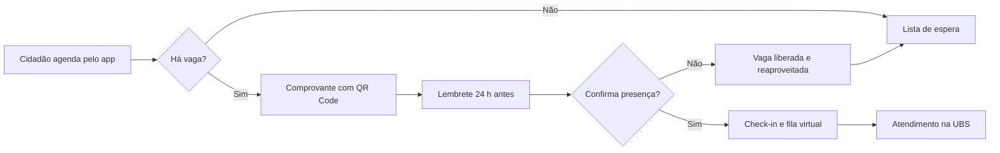

<a id="mvp"></a>

## ▶️ MVP funcional

Além da documentação, o repositório traz um **MVP que roda**: aplicativo em **Flask**, banco **SQLite**, QR Code, fila virtual e painel da recepção, com **10 testes automatizados** no GitHub Actions.

```bash
cd app
pip install -r requirements.txt
python app.py        # http://127.0.0.1:5000
```

<div align="center">
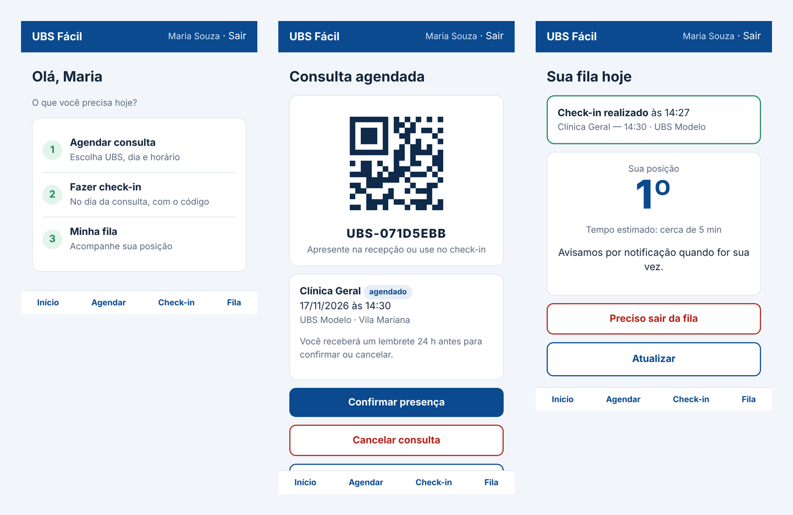
<br><sub>Aplicativo do cidadão rodando: início, comprovante com QR Code e fila virtual</sub>
<br><br>
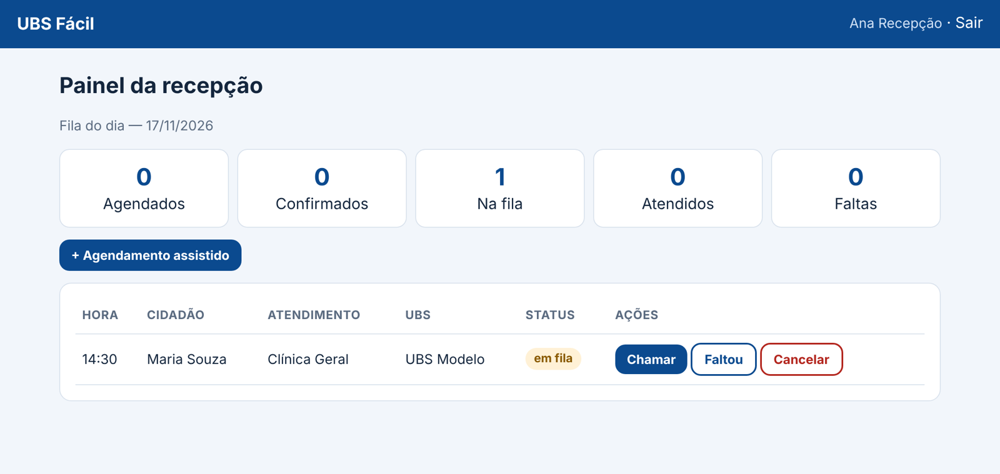
<br><sub>Painel da recepção com a fila do dia</sub>
</div>

Mais detalhes, usuários de demonstração e mapa de requisitos em [`app/README.md`](app/README.md).

<a id="prototipo"></a>

## 📱 Protótipo

Seis telas, da entrada do cidadão ao painel da recepção.

<div align="center">
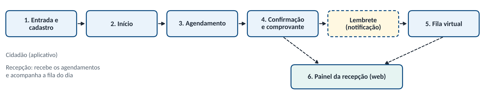
<br><br>
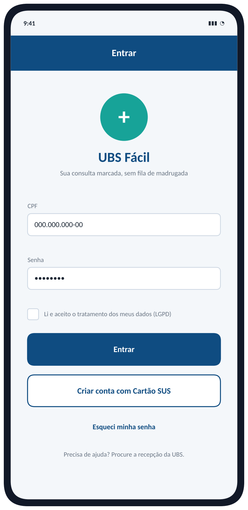
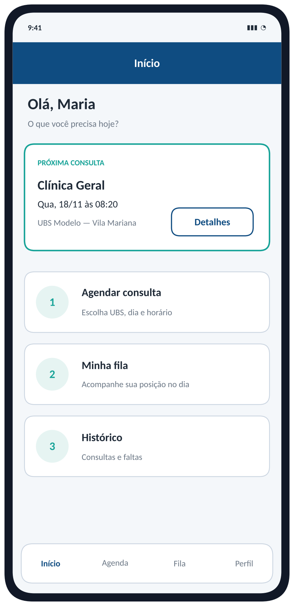
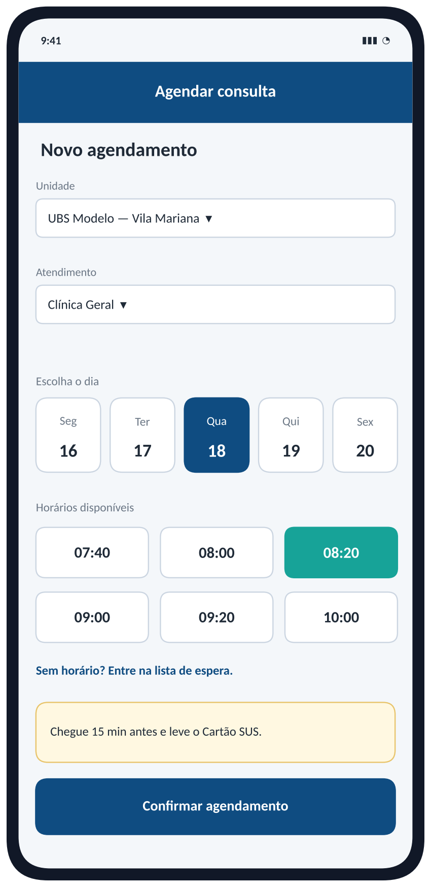
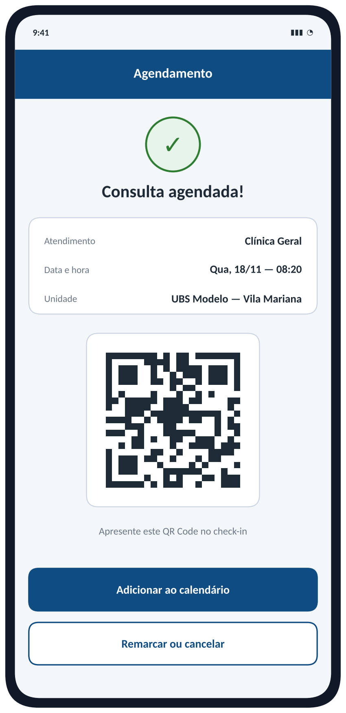
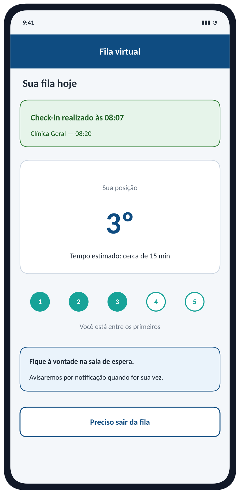
<br>
<sub>Login · Início · Agendar · Confirmação · Fila virtual</sub>
<br><br>
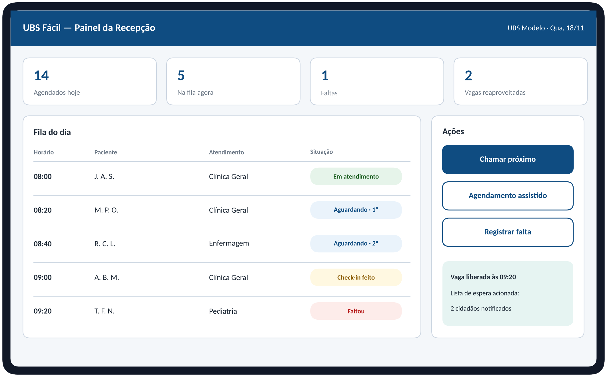
<br>
<sub>Painel web da recepção</sub>
</div>

<a id="bpmn"></a>

## 🔄 Processos BPMN

O processo de agendamento hoje (**AS-IS**) e o processo proposto (**TO-BE**), modelados em BPMN 2.0. Os arquivos `.bpmn` ficam em [`bizagi/`](bizagi) e abrem no Bizagi Modeler.

**AS-IS: como funciona hoje (3 raias)**

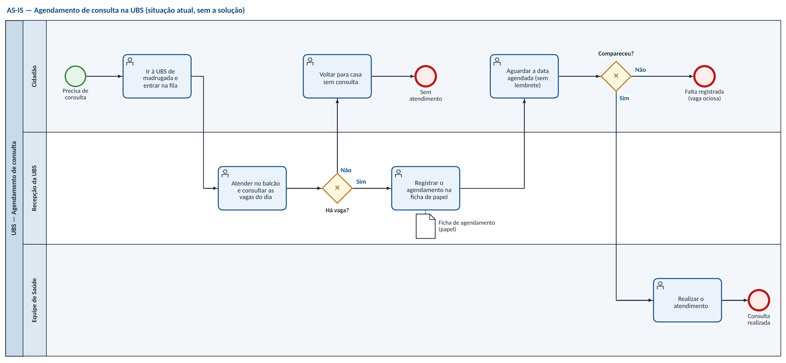

**TO-BE: com o UBS Fácil (4 raias, incluindo o Sistema)**

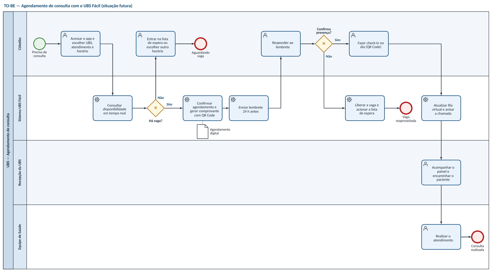

<a id="storyboard"></a>

## 🎞️ Storyboard

A jornada da Maria em oito quadros, do problema ao atendimento.

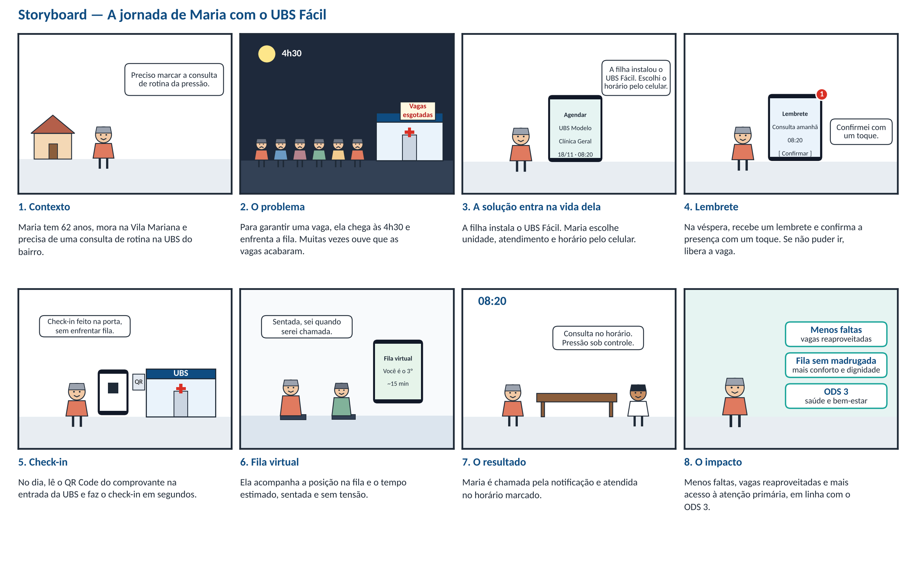

<a id="backlog"></a>

## 🗂️ Backlog e Sprints

**13 requisitos** (8 funcionais e 5 não funcionais), priorizados por **MoSCoW** e estimados em **story points**.

| Sprint | Meta | Itens | Pontos |
|---|---|---|---|
| **1** · semana 1 | O cidadão se cadastra, agenda e recebe o comprovante | RF01, RF02, RF03, RNF01, RNF02 | 17 |
| **2** · semana 2 | Reduzir faltas e filas no dia do atendimento | RF04, RF05, RF06, RF07, RNF03, RNF04 | 20 |

Detalhes, critérios de aceite e técnicas de levantamento em [`docs/backlog.md`](docs/backlog.md).

<details>
<summary><b>Processo de produção de SI</b> (clique para abrir)</summary>

<br>

- **Ciclo de vida:** incremental, com entregas parciais que já geram valor ([ADR-001](docs/decisoes/ADR-001-ciclo-de-vida-incremental.md)).
- **Processo:** ágil, com **Scrum** ([ADR-002](docs/decisoes/ADR-002-processo-agil-scrum.md)).
- **Papéis:** Product Owner e Scrum Master alternam entre os integrantes a cada Sprint.
- **Definition of Done:** o item cumpre o checklist da entrega e está publicado neste repositório.
- **Restrições:** equipe fixa de 3 pessoas; prazo e escopo ajustados pelo Backlog.

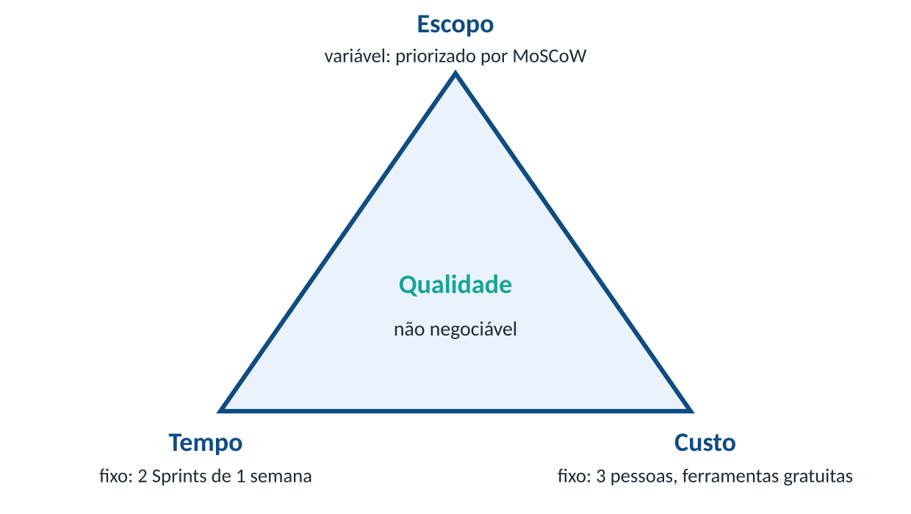

</details>

## 📦 Entregas da disciplina

| Entrega | Onde está |
|---|---|
| 📄 **Documento único** (capa, D1 a D4, referências) | [`entrega/UBS-Facil_GS2026-2_BSPAD.pdf`](entrega/UBS-Facil_GS2026-2_BSPAD.pdf) |
| **D1** · Processo de produção de SI | PDF, [`docs/backlog.md`](docs/backlog.md) e [`docs/decisoes/`](docs/decisoes) |
| **D2** · BPMN AS-IS e TO-BE | [`diagramas/`](diagramas) e [`bizagi/`](bizagi) |
| **D3** · Protótipo | [`pencil/`](pencil) |
| **D4** · Storyboard | [`storyboard/`](storyboard) |

## 🧭 Estrutura do repositório

```text
UbsFacilGs/
├── app/           MVP funcional (Flask + SQLite) e testes
├── bizagi/        modelos BPMN (AS-IS e TO-BE)
├── diagramas/     imagens dos diagramas
├── pencil/        telas do protótipo e mapa de navegação
├── storyboard/    storyboard da jornada do cidadão
├── docs/          backlog, ADRs, roteiro de entrevista, sprints
├── entrega/       PDF único da entrega
├── scripts/       issues do Backlog e histórico Git
└── .github/       templates de issue/PR e validação automática
```

## 🔧 Fluxo de trabalho no Git

- `main` recebe alterações somente por **Pull Request**.
- Branches por entrega: `feat/d2-bpmn`, `docs/d1-backlog`, `fix/legenda-tela-3`.
- Commits no padrão [Conventional Commits](https://www.conventionalcommits.org/pt-br/): `feat`, `docs`, `fix`, `chore`, `ci`.
- Cada requisito do Backlog vira uma issue (`scripts/criar_issues.sh`).
- A tag `v1.0.0` marca a entrega da GS 2026.2.

Mais em [`CONTRIBUTING.md`](CONTRIBUTING.md).

<a id="equipe"></a>

## 👥 Equipe

<div align="center">

| William Philip Oliveira Cardoso | Tomas Marques | João Siroky |
|:---:|:---:|:---:|
| RM 567157 | RM 567296 | RM 556076 |


FIAP · Sistemas de Informação · 2SI · 2026

</div>

## 📄 Licença

Distribuído sob a licença [MIT](LICENSE).

<div align="center"><sub>Feito com cuidado por quem já viu uma fila de madrugada na porta da UBS.</sub></div>
